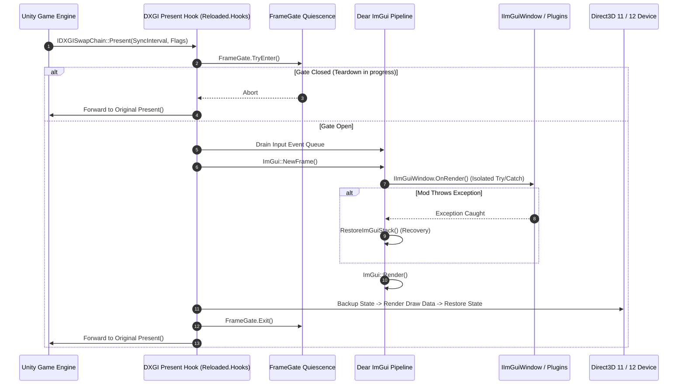

# DearImGuiInjectionPlus

[](https://github.com/Klax-xon/DearImGuiInjectionPlus)
[](https://docs.microsoft.com/en-us/dotnet/standard/net-standard)
[](https://github.com/BepInEx/BepInEx)
[](https://docs.microsoft.com/en-us/windows/win32/direct3d)
[](https://github.com/ocornut/imgui)
[](#zero-allocation-architecture)
[](LICENSE)

A high-performance unmanaged/managed hybrid injection framework engineered to embed **[Dear ImGui](https://github.com/ocornut/imgui)** directly into **Unity** DirectX swapchains under **[BepInEx 5](https://github.com/BepInEx/BepInEx)**.

`DearImGuiInjectionPlus` delivers an ultra-stable, crash-resilient developer GUI layer for modders and game reverse-engineers. By hooking the engine's DXGI swapchain at the native level, it renders high-framerate, immediate-mode interfaces without relying on intermediate C++ proxy DLLs, without interfering with Unity's internal rendering pipelines, and without allocating managed heap memory inside the render loop.

---

## Table of Contents

- [Key Architectural Features](#key-architectural-features)
- [Supported Environments](#supported-environments)
- [Installation & Setup](#installation--setup)
  - [For Players & Mod Users](#for-players--mod-users)
  - [Configuration File (`DearImGuiInjectionPlus.cfg`)](#configuration-file-dearimguiinjectionpluscfg)
- [Developer Integration Guide](#developer-integration-guide)
  - [1. Manifest & Assembly Dependencies](#1-manifest--assembly-dependencies)
  - [2. Modular Windows (`IImGuiWindow`)](#2-modular-windows-iimguiwindow-recommended)
  - [3. Main Menu Bar Tabs (`RegisterTab`)](#3-main-menu-bar-tabs-registertab)
  - [4. Thread-Safe State Pipelines (`StateSnapshotPipeline` & `StructSnapshotPipeline`)](#4-thread-safe-state-pipelines-lock-free)
  - [5. Dispatched Engine Mutations (`UnityMainThreadDispatcher`)](#5-dispatched-engine-mutations-unitymainthreaddispatcher)
  - [6. Real-Time Diagnostics (`GraphicsTelemetry`)](#6-real-time-diagnostics-graphicstelemetry)
  - [7. Legacy Render Delegate (`Render`)](#7-legacy-render-delegate-render)
- [Threading Architecture & Execution Model](#threading-architecture--execution-model)
  - [Context Affinity Rules](#context-affinity-rules)
  - [Injection Pipeline & Data Flow](#injection-pipeline--data-flow)
  - [Quiescent Teardown & `FrameGate`](#quiescent-teardown--framegate)
  - [COM Reference Balance & SharpDX Safety](#com-reference-balance--sharpdx-safety)
- [Diagnostics & Test Bench (`TestPlugin`)](#diagnostics--test-bench-testplugin)
- [Building from Source](#building-from-source)
- [Roadmap & Reference Documentation](#roadmap--reference-documentation)
- [Credits & Attribution](#credits--attribution)
- [License](#license)

---

## Key Architectural Features

### 🎮 Native DirectX 11 & DirectX 12 Pipelines
- **Direct DXGI Hooking**: Hooks `IDXGISwapChain::Present` (VTable slot 8) and `IDXGISwapChain1::Present1` (VTable slot 22) dynamically using [`Reloaded.Hooks`](https://github.com/Reloaded-Project/Reloaded.Hooks).
- **Direct3D 11 Backend**: Custom managed D3D11 backend featuring deterministic `StateBackup` capture and restoration, immediate-context rasterizer state recovery, and direct VTable-level shader resource binding (`PSSetShaderResources` slot 8) bypassing wrapper allocations.
- **Direct3D 12 Backend**: Native command queue acquisition via swapchain device query (`GetDevice` / `QueryInterface` on `Present`), ring-buffered per-backbuffer `FrameContext` allocators, automatic fence synchronization (`WaitForGpuIdle`), and dynamic root signature / PSO adaptation.
- **Dynamic SwapChain & Device Loss Recovery**: Seamlessly updates active swapchain pointers upon resolution and window mode changes on the same `HWND`. In the event of a GPU driver crash or TDR (`DeviceRemovedReason.Failure`), stale GPU interfaces are invalidated and automatically reconstructed without crashing the game.
- **HDR & Extended Color Space Support**: Dynamically detects backbuffer formats (`R8G8B8A8_UNorm`, `B8G8R8A8_UNorm_SRgb`, `R10G10B10A2_UNorm`, `R16G16B16A16_Float`), automatically instantiates matching D3D12 render target PSOs, and applies gamma compensation to prevent color washout on HDR10 and scRGB displays.

### 🛡️ Non-Destructive Win32 Subclassing & Multi-Layer Input Swallowing
- **Safe Subclassing**: Window interception uses `Comctl32.SetWindowSubclass` / `RemoveWindowSubclass` marshaled strictly to the window-owning thread. Coexists harmoniously with other Win32 hooks and preserves Unicode window procedures (`IsWindowUnicode`).
- **Comprehensive Multi-Layer Swallowing**:
  1. **Win32 Message Pump**: Swallows raw input (`WM_INPUT`), mouse clicks, and keystrokes based on `BlockAllInputsWhenOpen` and ImGui capture flags (`WantCaptureMouse`, `WantCaptureKeyboard`). `Alt+Enter` is whitelisted directly to `DefSubclassProc` to preserve fullscreen switching.
  2. **Legacy Unity Input**: Harmony prefix patches intercept `UnityEngine.Input` (`GetAxis`, `GetKey`, `GetButton`, `mousePosition`, `mouseScrollDelta`).
  3. **Unity New Input System**: Dynamic reflection detour for `UnityEngine.InputSystem.InputSystem` suppresses and restores hardware devices on the fly without introducing hard compile-time dependencies.
  4. **uGUI Canvas Shielding**: MonoMod runtime detour on `UnityEngine.EventSystems.EventSystem.Update` prevents mouse clicks on ImGui windows from penetrating underlying game canvas buttons.
- **Stuck-Key & Drift Prevention**: Tracks held keys upon menu opening in a 256-bit bitmask (`GetAsyncKeyState`). Synthesizes `WM_KEYUP` notifications when the menu closes to prevent player characters from moving or firing perpetually. Mouse cursor lock (`CursorLockMode.None`) and clipping bounds (`ClipCursor(NULL)`) are cleanly managed.
- **Full Unicode & IME Candidate Support**: `WM_CHAR`, `WM_IME_CHAR`, and `WM_UNICHAR` (including UTF-16 surrogate pairs for supplementary emojis `0x10000`–`0x10FFFF`) are routed directly into ImGui. IME system messages dispatch to `DefWindowProcW` while typing, allowing IME composition windows to function natively.

### ⚡ Zero-Allocation Render Loop & Concurrency Pipelines
- **Zero Steady-State Managed Allocations**: Eliminates heap churn on the render thread. All render-loop collections (tabs, modular windows, delegates) use pre-cached snapshots that only rebuild upon registration changes. Dynamic vertex and index buffers grow logarithmically and reuse native memory.
- **Thread-Isolated Input Queue**: The Win32 WndProc never touches `ImGuiIO` directly. Input messages are packaged into zero-allocation `InputEvent` structs and pushed to a lock-free `ConcurrentQueue<InputEvent>`, drained exclusively on the DXGI `Present` thread.
- **Lock-Free State Pipelines**:
  - `StateSnapshotPipeline<T>` (for reference types): Atomic snapshot exchange via `Interlocked.Exchange` and `Volatile.Read`.
  - `StructSnapshotPipeline<T>` (for value types): Triple-buffered atomic slot exchange (`_slot0`, `_slot1`, `_slot2`) with flag masking, guaranteeing **zero torn reads** and **zero boxing allocations** under extreme write frequencies (up to 10,000 Hz).
- **Fault-Isolated Execution & Recovery**: Every modular window and menu tab runs inside isolated `try/catch` boundaries backed by `RestoreImGuiStack()` (`igErrorCheckEndFrameRecover`) and `RestoreImGuiWindowStack()` (`igErrorCheckEndWindowRecover`). A third-party mod throwing an exception cannot corrupt the ImGui stack, break other mods, or crash the host process.
- **Circuit Breaker Protection**: If an unhandled backend rendering error occurs for 5 consecutive frames, a circuit breaker trips, pausing rendering for 5 seconds to prevent frame-rate collapse and log flooding (60–240 stack traces per second).

---

## Supported Environments

| Component | Supported Version / Requirement | Notes |
| :--- | :--- | :--- |
| **Operating System** | **Windows 10 / 11 (x64)** | 64-bit architecture required (uses 64-bit `ImTextureID`). |
| **Unity Engine** | **Unity 2017.x through Unity 6** | Certified on Unity 2017, 2018, 2019 LTS, 2020, 2021 LTS, 2022 LTS, and Unity 6 Mono runtimes. |
| **Scripting Backend** | **Mono** (`netstandard2.0`) | Full compatibility with BepInEx 5 Mono hooks. |
| **Modding Host** | **BepInEx 5.4.x** (v5.4.21+ recommended) | Standard `BaseUnityPlugin` architecture. |
| **Graphics APIs** | **Direct3D 11** & **Direct3D 12** | Auto-detected from `SystemInfo.graphicsDeviceType`. |
| **Dear ImGui** | **v1.89.9 Docking** (`cimgui.dll` / `ImGui.NET`) | Multi-docking, custom viewports, font atlas baking. |

> [!NOTE]
> **Unsupported Graphics Backends**: OpenGL, Vulkan, and Metal are not supported. When launched under an unsupported backend, `DearImGuiInjectionPlus` logs an informative error and cleanly aborts initialization without installing native DXGI hooks or intercepting window procedures.

---

## Installation & Setup

### For Players & Mod Users

1. **Install BepInEx 5 (x64)**:
   - Ensure your Unity game is modded with **BepInEx 5.4.x (64-bit)**.
2. **Download Release**:
   - Download the latest `DearImGuiInjectionPlus-v1.0.0.zip` from [Releases](https://github.com/Klax-xon/DearImGuiInjectionPlus/releases).
3. **Extract to Plugins**:
   - Extract the contents into your game's `BepInEx/plugins/` directory:
     ```
     <GameDirectory>/
     └── BepInEx/
         └── plugins/
             └── DearImGuiInjectionPlus/
                 ├── DearImGuiInjectionPlus.dll
                 ├── RendererFinder.dll
                 ├── ImGui.NET.dll
                 ├── cimgui.dll
                 ├── Reloaded.Hooks.dll
                 ├── Reloaded.Hooks.Definitions.dll
                 ├── Reloaded.Memory.dll
                 ├── Reloaded.Memory.Buffers.dll
                 ├── Reloaded.Assembler.dll
                 ├── Iced.dll
                 ├── FASM.DLL
                 ├── FASMX64.DLL
                 ├── SharpDX.dll
                 ├── SharpDX.DXGI.dll
                 ├── SharpDX.Direct3D11.dll
                 ├── SharpDX.Direct3D12.dll
                 └── Assets/
                     ├── Fonts/
                     │   └── Comfortaa-Medium.ttf
                     └── Shaders/
                         ├── imgui-vertex.hlsl.bytes
                         └── imgui-frag.hlsl.bytes
     ```
4. **Launch the Game**:
   - Press **`Insert`** on your keyboard to toggle the Dear ImGui cursor and overlay.
   - UI layout and docking configurations are saved automatically to `BepInEx/config/DearImGuiInjectionPlus_imgui.ini`.

### Configuration File (`DearImGuiInjectionPlus.cfg`)

After the first game launch, a configuration file is generated at `BepInEx/config/DearImGuiInjectionPlus.cfg`:

```ini
[Keybinds]

## Key for switching the Dear ImGui cursor and menu visibility.
# Setting type: VirtualKey
# Default value: Insert
CursorVisibility = Insert

[InputBlocking]

## Whether all game mouse clicks and keyboard inputs are swallowed while the menu is open.
## If set to false, inputs are only swallowed when ImGui explicitly requests capture (WantCaptureMouse/Keyboard).
# Setting type: Boolean
# Default value: true
BlockAllInputsWhenOpen = true
```

---

## Developer Integration Guide

`DearImGuiInjectionPlus` provides a modern, clean, and thread-safe API for mod developers.

### 1. Manifest & Assembly Dependencies

Add references to `DearImGuiInjectionPlus.dll` and `ImGui.NET.dll` in your C# project. Then declare the BepInEx dependency on your plugin class:

```csharp
using BepInEx;
using DearImGuiInjectionPlus;

namespace MyCustomMod;

[BepInPlugin("com.author.mycustommod", "My Custom Mod", "1.0.0")]
[BepInDependency(DearImGuiInjectionPlus.Metadata.GUID, BepInDependency.DependencyFlags.HardDependency)]
public class MyCustomModPlugin : BaseUnityPlugin
{
    private void Awake()
    {
        Logger.LogInfo("MyCustomMod loaded and bound to DearImGuiInjectionPlus!");
    }
}
```

---

### 2. Modular Windows (`IImGuiWindow`) [Recommended]

The `IImGuiWindow` interface provides isolated exception handling, unique window tracking, and automatic docking integration.

```csharp
using System.Numerics;
using DearImGuiInjectionPlus;
using ImGuiNET;

namespace MyCustomMod;

public class MyModSettingsWindow : IImGuiWindow
{
    public string Id => "my_custom_mod_settings";
    public string Title => "My Custom Mod Settings";
    public bool IsOpen { get; set; } = true;

    private float _multiplier = 1.0f;
    private bool _enableGodMode = false;

    public void OnRender()
    {
        bool open = IsOpen;
        if (ImGui.Begin(Title, ref open, ImGuiWindowFlags.AlwaysAutoResize))
        {
            IsOpen = open;

            ImGui.TextColored(new Vector4(0.4f, 0.8f, 1.0f, 1.0f), "Configuration Panel");
            ImGui.Separator();

            ImGui.SliderFloat("Speed Multiplier", ref _multiplier, 0.1f, 10.0f);
            ImGui.Checkbox("God Mode", ref _enableGodMode);

            if (ImGui.Button("Reset Defaults"))
            {
                _multiplier = 1.0f;
                _enableGodMode = false;
            }
        }
        ImGui.End();
    }
}
```

#### Registering & Unregistering the Window:

```csharp
public class MyCustomModPlugin : BaseUnityPlugin
{
    private MyModSettingsWindow _window;

    private void OnEnable()
    {
        _window = new MyModSettingsWindow();
        DearImGuiInjectionPlus.DearImGuiInjectionPlus.RegisterWindow(_window);
    }

    private void OnDisable()
    {
        DearImGuiInjectionPlus.DearImGuiInjectionPlus.UnregisterWindow(_window);
        _window = null;
    }
}
```

> [!TIP]
> **Automatic Fault Recovery**: If code inside `OnRender()` throws an exception, `DearImGuiInjectionPlus` catches it, logs the error once, and executes `RestoreImGuiStack()` (`igErrorCheckEndFrameRecover`). Your broken window will not crash the host game or freeze Dear ImGui for other mods.

---

### 3. Main Menu Bar Tabs (`RegisterTab`)

You can register menu dropdowns into the top-level ImGui menu bar. `RegisterTab` deduplicates entries by category/title and returns an `IDisposable` token for clean lifecycle teardown:

```csharp
using System;
using DearImGuiInjectionPlus;
using ImGuiNET;

public class MyCustomModPlugin : BaseUnityPlugin
{
    private IDisposable _menuTabHandle;
    private MyModSettingsWindow _window;

    private void OnEnable()
    {
        _window = new MyModSettingsWindow();
        DearImGuiInjectionPlus.DearImGuiInjectionPlus.RegisterWindow(_window);

        // Adds an item under the "Mods" menu category
        _menuTabHandle = DearImGuiInjectionPlus.DearImGuiInjectionPlus.RegisterTab(
            category: "Mods",
            title: "My Mod Settings",
            callback: () =>
            {
                if (ImGui.MenuItem("Open Settings Window", "", _window.IsOpen))
                {
                    _window.IsOpen = !_window.IsOpen;
                }
            });
    }

    private void OnDisable()
    {
        // Automatically removes the menu entry
        _menuTabHandle?.Dispose();
        _menuTabHandle = null;

        DearImGuiInjectionPlus.DearImGuiInjectionPlus.UnregisterWindow(_window);
    }
}
```

---

### 4. Thread-Safe State Pipelines (Lock-Free)

> [!CRITICAL]
> **The Thread-Boundary Golden Rule**:
> ImGui rendering executes on the **DirectX Present Thread**. Unity engine objects (`UnityEngine.GameObject`, `Transform`, `Camera`, `Component`) **cannot** be read or modified outside the Unity Main Thread.
>
> Use `StateSnapshotPipeline<T>` or `StructSnapshotPipeline<T>` to pass state from Unity to ImGui without locks or allocations.

#### Reference Types (`StateSnapshotPipeline<T>`):
```csharp
public class GameSnapshot
{
    public string SceneName;
    public float PlayerHealth;
    public UnityEngine.Vector3 PlayerPosition;
}

// 1. Instantiate the pipeline
var pipeline = new StateSnapshotPipeline<GameSnapshot>();

// 2. On Unity Main Thread (e.g. Update):
pipeline.Publish(new GameSnapshot
{
    SceneName = SceneManager.GetActiveScene().name,
    PlayerHealth = player.Health,
    PlayerPosition = player.transform.position
});

// 3. On ImGui Render Thread (inside IImGuiWindow.OnRender):
var snapshot = pipeline.GetLatest();
if (snapshot != null)
{
    ImGui.Text($"Scene: {snapshot.SceneName}");
    ImGui.Text($"Health: {snapshot.PlayerHealth:F1}");
}
```

#### Value Types (`StructSnapshotPipeline<T>`):
For high-frequency telemetry (e.g. transforms, telemetry vectors, matrix structures), `StructSnapshotPipeline<T>` uses a triple-buffered atomic index exchange that eliminates GC allocations entirely and guarantees zero torn reads:

```csharp
public struct TransformTelemetry
{
    public float PosX, PosY, PosZ;
    public float RotX, RotY, RotZ, RotW;
}

var structPipeline = new StructSnapshotPipeline<TransformTelemetry>();

// Main Thread:
structPipeline.Publish(in telemetryData);

// Render Thread:
TransformTelemetry data = structPipeline.GetLatest();
```

---

### 5. Dispatched Engine Mutations (`UnityMainThreadDispatcher`)

When a user clicks a button or interacts with a widget in Dear ImGui and you need to perform an action in Unity (such as spawning an object, altering physics, or loading a level), marshal the action to the Unity Main Thread:

```csharp
using DearImGuiInjectionPlus.BepInEx;
using UnityEngine;

public void OnRender()
{
    if (ImGui.Button("Spawn Companion Cube"))
    {
        // Enqueue action to execute safely during the next Unity Update loop
        UnityMainThreadDispatcher.Enqueue(() =>
        {
            var cube = GameObject.CreatePrimitive(PrimitiveType.Cube);
            cube.name = "SpawnedCube_" + Time.time;
            cube.transform.position = Vector3.forward * 2f;
        });
    }
}
```

> [!WARNING]
> **Never Call Blocking `InvokeOnMainThread` From Render Thread**:
> Synchronous blocking dispatch (`InvokeOnMainThread`) must **never** be called from within `IImGuiWindow.OnRender()` or ImGui callbacks. Unity's main thread frequently waits on the render thread to finish swapchain presentation; blocking the render thread while waiting on the main thread creates an immediate **engine deadlock**. Always use asynchronous `Enqueue()`.

---

### 6. Real-Time Diagnostics (`GraphicsTelemetry`)

`DearImGuiInjectionPlus` publishes live swapchain telemetry updated every frame:

```csharp
using DearImGuiInjectionPlus;

string backend = GraphicsTelemetry.BackendName;        // "Direct3D 11" or "Direct3D 12"
string format  = GraphicsTelemetry.BackBufferFormat;   // e.g. "R8G8B8A8_UNorm", "R10G10B10A2_UNorm"
bool isHdr     = GraphicsTelemetry.IsHdr;              // true if HDR10 or scRGB active
int resWidth   = GraphicsTelemetry.Width;              // e.g. 2560
int resHeight  = GraphicsTelemetry.Height;             // e.g. 1440
float hz       = GraphicsTelemetry.RefreshRateHz;      // e.g. 144.0 Hz
int vtxCount   = GraphicsTelemetry.TotalVertices;      // ImGui vertices rendered this frame
```

---

### 7. Legacy Render Delegate (`Render`)

If you prefer subscribing directly to an event delegate rather than implementing `IImGuiWindow`:

```csharp
public class MySimpleMod : BaseUnityPlugin
{
    private void OnEnable()
    {
        DearImGuiInjectionPlus.DearImGuiInjectionPlus.Render += DrawSimpleUI;
    }

    private void OnDisable()
    {
        DearImGuiInjectionPlus.DearImGuiInjectionPlus.Render -= DrawSimpleUI;
    }

    private static void DrawSimpleUI()
    {
        if (DearImGuiInjectionPlus.DearImGuiInjectionPlus.IsCursorVisible)
        {
            ImGui.Begin("Simple Mod Window");
            ImGui.Text("Hello from legacy delegate!");
            ImGui.End();
        }
    }
}
```

---

## Threading Architecture & Execution Model

Embedding immediate-mode GUI into an existing DirectX engine requires strict discipline across three distinct operating environments:

```
+--------------------------------------------------------------------------------------------------+
|                                    Three-Thread Execution Model                                  |
+--------------------------------------------------------------------------------------------------+

   [ Win32 Message Thread ]          [ Unity Main Thread ]               [ DirectX Present Thread ]
        (WndProc Pump)               (Game Engine Update)                  (Graphics Presentation)
              |                               |                                      |
       Comctl32 Subclass                      |                                      |
              |                               |                                      |
    InputEvent Enqueue                        |                                      |
   (Thread-Safe Queue)                        |                                      |
              |                               |                                      |
              |                    StateSnapshot.Publish()                           |
              |                    (Atomic State Pipeline)                           |
              |                               |                                      |
              +-------------------------------+------------------------------------->|
                                                                                     |
                                                                           FrameGate.TryEnter()
                                                                                     |
                                                                           Drain InputEvent Queue
                                                                                     |
                                                                           ImGui.NewFrame()
                                                                                     |
                                                                           IImGuiWindow.OnRender()
                                                                           (Reads Latest Snapshot)
                                                                                     |
                                                                           Dispatcher.Enqueue()
                                                                           (Marshals Back to Unity)
                                                                                     |
                                                                           ImGui.Render()
                                                                                     |
                                                                           D3D11 / D3D12 Draw
                                                                                     |
                                                                           Original Present()
                                                                                     |
                                                                           FrameGate.Exit()
```

### Context Affinity Rules

| Execution Context | Thread Identity | Allowed Operations | Strictly Prohibited Operations |
| :--- | :--- | :--- | :--- |
| **Unity Main Thread** | Unity Scripting Thread (`IsMainThread == true`) | Accessing `UnityEngine.Object` APIs, GameObjects, Transforms, Physics, SceneManager, Publishing to `StateSnapshotPipeline.Publish()`, Subclassing via `Comctl32`. | Calling ImGui rendering functions (`ImGui.Begin`, `Text`, etc.). ImGui is bound to the render thread context. |
| **DirectX Present Thread** | Graphics Device Present Thread (DXGI `Present` hook) | `ImGui.NewFrame()`, `ImGui.Render()`, `IImGuiWindow.OnRender()`, DirectX device draw calls, Reading `StateSnapshotPipeline.GetLatest()`. | Calling ANY `UnityEngine.Object` methods, instantiating GameObjects, or calling blocking `InvokeOnMainThread` (deadlock!). |
| **Win32 Message Thread** | OS UI Message Pump | `InputManager.SubclassHandler`, mouse cursor clipping, raw input routing, packaging `InputEvent` structs into `ConcurrentQueue`. | Long-running operations, blocking waits (stalls message pump), direct `ImGui` or `ImGuiIO` mutations. |

---

### Injection Pipeline & Data Flow



---

### Quiescent Teardown & `FrameGate`

Many injection libraries suffer from fatal crashes upon game exit because tearing down hooks or freeing unmanaged buffers while the GPU render thread is in the middle of executing a frame triggers native Access Violations (`0xC0000005`). Historically, authors worked around this by invoking destructive hacks like `Process.GetCurrentProcess().Kill()`.

`DearImGuiInjectionPlus` replaces this with the **`FrameGate` Inverted Quiescence Protocol**:

1. **Shutdown Signal**: During `DearImGuiInjectionPlusBaseUnityPlugin.OnDestroy()`, `RendererFinder.IsShuttingDown` is set to `true`.
2. **Frame Drain**: `FrameGate.CloseAndDrain(1000)` transitions the atomic frame state to closed and waits for all in-flight render threads to exit. If the drain times out, teardown aborts safely to prevent use-after-free crashes.
3. **Hook Deactivation**: `Reloaded.Hooks` detours are disabled cleanly.
4. **Subclass Removal**: Window subclassing is detached via `Comctl32.RemoveWindowSubclass` marshaled to the window-owning thread.
5. **GPU Flush**: The GPU pipeline is drained (`_deviceContext.Flush()` on D3D11; fence synchronization `WaitForGpuIdle()` on D3D12).
6. **Context Teardown**: ImGui ini settings are persisted to disk, the `ImGuiContext` is destroyed, and unmanaged string buffers (`_iniFilenamePtr`) are freed safely.
7. **Clean Exit**: The process exits with exit code `0`, allowing all other BepInEx plugins to complete their `OnDestroy` save logic.

---

### COM Reference Balance & SharpDX Safety

When interacting with native DirectX interfaces under SharpDX in a managed environment:
- **Borrowed References**: Any native COM pointer obtained from Unity (such as swapchains in `Present` or fallback D3D12 command queues) is wrapped in SharpDX objects only after explicitly calling `Marshal.AddRef(ptr)`. This guarantees that when SharpDX calls `Release()` upon `.Dispose()`, it balances the reference and does not over-release the engine's internal DirectX objects.
- **Finalizer Defense**: SharpDX wrappers created over engine interfaces are shielded with `GC.SuppressFinalize` to prevent non-deterministic garbage collector finalizers from over-releasing objects during teardown.
- **Deterministic State Backup**: In Direct3D 11, pipeline state snapshots (`StateBackup`) are scoped to `IDisposable` singletons that clear scissor rectangles and viewport arrays deterministically, allowing `IDXGISwapChain::ResizeBuffers` to succeed without interface lockups.

---

## Diagnostics & Test Bench (`TestPlugin`)

The repository includes a comprehensive, production-grade diagnostic test bench: `TestPlugin`.

Built to execute the automated stress harnesses specified in [`TEST-MATRIX.md`](TEST-MATRIX.md), `TestPlugin` provides a unified in-game dashboard (`TestSuiteMasterPanel`) with five dedicated diagnostic panels:

```
+--------------------------------------------------------------------------------------------------+
|                            TestPlugin Diagnostic Architecture                                    |
+--------------------------------------------------------------------------------------------------+
                                                  |
                                       [TestSuiteMasterPanel]
                                 Unified Master In-Game Dashboard
                                                  |
         +-----------------------+-----------------------+-----------------------+
         |                       |                       |                       |
[GraphicsTestPanel]     [ConcurrencyTestPanel]    [InputTestPanel]    [FaultRecoveryTestPanel]
  - Live Telemetry        - High-Hz Writer Worker - Multilingual UTF-8 - Fault A: Window Stack
  - Buffer Burst Stress   - StructSnapshot Verify - Dead Keys / IME    - Fault B: Menu Stack
  - UserCallback -1 Test  - Dispatcher Torture    - Stuck-Key Monitor  - Fault C: Tab Churn
  - HDR / SDR Tone Check  - Torn-Read Detection   - Raw Input Capture  - Teardown Timestamp
                                                                                 |
                                                                    [MemoryBenchmarkTestPanel]
                                                                      - Win32 PSAPI Private Bytes
                                                                      - Rolling FPS / Delta Graphs
                                                                      - Managed GC Heaps (0/1/2)
```

- **`GraphicsTestPanel` (TM-01, TM-02, TM-03, TM-08)**: Live swapchain and resolution telemetry; dynamically generates geometry bursts from 1,000 to 25,000+ primitives (>100,000 vertices/indices) across backbuffers to stress dynamic buffer reallocations; validates custom `UserCallback` `-1` render state resets.
- **`ConcurrencyTestPanel` (TM-04)**: Spawns a dedicated background worker publishing multi-field payloads at up to 10,000 Hz into `StructSnapshotPipeline<T>`, asserting zero torn reads on the render thread.
- **`InputTestPanel` (TM-05, TM-06)**: Validates Unicode dead keys, German umlauts, French accents, Cyrillic, CJK IME candidate windows, and supplementary emojis (`WM_UNICHAR`); monitors `User32.IsWindowUnicode` status.
- **`FaultRecoveryTestPanel` (TM-07, TM-10)**: Injects deliberate stack corruptions (throwing mid-`ImGui.Begin()`, unclosed `BeginMenu()`) to prove runtime recovery without crashing the game; writes a shutdown timestamp file during `OnDestroy` to certify clean teardown.
- **`MemoryBenchmarkTestPanel` (TM-09)**: Monitors real-time process private memory via Win32 PSAPI, dedicated VRAM, rolling FPS graphs, and managed garbage collector generational heaps (`Gen 0`, `Gen 1`, `Gen 2`).

---

## Building from Source

### Prerequisites
- **.NET SDK** (supporting `netstandard2.0`, e.g. .NET 8.0 SDK or .NET 9.0 SDK).
- **Windows 10 / 11 (x64)**.
- **Visual Studio 2022** or **VS Code** with C# Dev Kit.

### Repository Layout
- `DearImGuiInjectionPlus/`: Main injection assembly, backends (D3D11, D3D12, Win32), input routing, and pipelines.
- `RendererFinder/`: Native hook engine, VTable pointer resolver, and `FrameGate` quiescence gate.
- `TestPlugin/`: Production validation test bench and diagnostic suite.
- `libs/`: Precompiled native binaries (`cimgui.dll` for x64/x86/ARM64, Linux, macOS) and assemblies (`ImGui.NET.dll`, Unity references).

### Compilation
Open a PowerShell terminal in the repository root and run:

```powershell
# Restore NuGet dependencies and build solution in Release mode
dotnet build -c Release
```

All compiled binaries and assets are unified directly to the `./bin/` directory:
- `DearImGuiInjectionPlus.dll`
- `RendererFinder.dll`
- `TestPlugin.dll`
- `cimgui.dll`
- `ImGui.NET.dll`
- `Reloaded.Hooks.dll` & dependencies
- `SharpDX*.dll`
- `Assets/` (Fonts & HLSL shader bytecodes)

---

## Roadmap & Reference Documentation

For deep technical insights into the implementation and verification of this framework, consult the internal architecture documentation:

- **[PROJECT-OVERVIEW.md](PROJECT-OVERVIEW.md)**: Exhaustive architectural specification, VTable offsets, COM safety rules, and lifecycle flows.
- **[AUDIT-VERDICT.md](AUDIT-VERDICT.md)**: Forensic stability certification, unmanaged memory safety verification, and release sign-off.
- **[TEST-MATRIX.md](TEST-MATRIX.md)**: Runtime test scenarios (`TM-01` through `TM-10`), pass/fail criteria, and stress benchmarks.
- **[PROJECT-ANALYSIS.md](PROJECT-ANALYSIS.md)**: Historical architectural audit and defect remediation register.

---

## Credits & Attribution

`DearImGuiInjectionPlus` stands on the shoulders of remarkable open-source projects and researchers:

- **[Dear ImGui](https://github.com/ocornut/imgui)** by [Omar Cornut (ocornut)](https://github.com/ocornut) — The industry-standard immediate-mode graphical user interface library for C++.
- **[ImGui.NET](https://github.com/mellinoe/ImGui.NET)** by [Eric Mellino (mellinoe)](https://github.com/mellinoe) — C# .NET wrapper for Dear ImGui.
- **[Sewer56](https://github.com/Sewer56)** — Author of the original `DearImGuiInjection` prototype and exploratory research into Unity DirectX swapchain hooking.
- **[Reloaded-Project](https://github.com/Reloaded-Project)** — [Reloaded.Hooks](https://github.com/Reloaded-Project/Reloaded.Hooks), high-performance inline detours and x86/x64 assembly generation.
- **[SharpDX](https://github.com/sharpdx/SharpDX)** by [Alexandre Mutel (xoofx)](https://github.com/xoofx) and the .NET Standard community maintainers.
- **[BepInEx Team](https://github.com/BepInEx/BepInEx)** & **[MonoMod](https://github.com/MonoMod/MonoMod)** — Extensible modding framework and runtime IL patching tools for Unity games.
- **[Klax-xon](https://github.com/Klax-xon)** — Architecture, Direct3D 11 & 12 custom managed backends, zero-allocation hardening, input swallowing, and test matrix suite.

---

## License

This project is licensed under the **[MIT License](LICENSE)**.

```
MIT License

Copyright (c) 2026 Klax-xon and DearImGuiInjectionPlus Contributors
Portions Copyright (c) Sewer56
Portions Copyright (c) 2014-2026 Omar Cornut (Dear ImGui)
Portions Copyright (c) 2017-2026 Eric Mellino (ImGui.NET)

Permission is hereby granted, free of charge, to any person obtaining a copy
of this software and associated documentation files (the "Software"), to deal
in the Software without restriction, including without limitation the rights
to use, copy, modify, merge, publish, distribute, sublicense, and/or sell
copies of the Software, and to permit persons to whom the Software is
furnished to do so, subject to the following conditions:

The above copyright notice and this permission notice shall be included in all
copies or substantial portions of the Software.

THE SOFTWARE IS PROVIDED "AS IS", WITHOUT WARRANTY OF ANY KIND, EXPRESS OR
IMPLIED, INCLUDING BUT NOT LIMITED TO THE WARRANTIES OF MERCHANTABILITY,
FITNESS FOR A PARTICULAR PURPOSE AND NONINFRINGEMENT. IN NO EVENT SHALL THE
AUTHORS OR COPYRIGHT HOLDERS BE LIABLE FOR ANY CLAIM, DAMAGES OR OTHER
LIABILITY, WHETHER IN AN ACTION OF CONTRACT, TORT OR OTHERWISE, ARISING FROM,
OUT OF OR IN CONNECTION WITH THE SOFTWARE OR THE USE OR OTHER DEALINGS IN THE
SOFTWARE.
```
